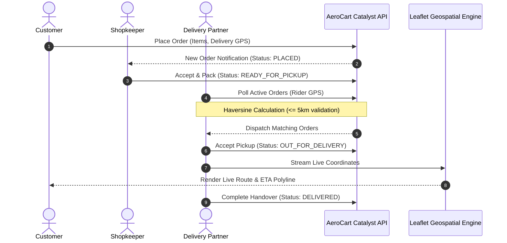

# AeroCart — Hyper-Local Quick-Commerce Platform

[](https://project-rainfall-60076287696.development.catalystserverless.in/app/)

[](https://nodejs.org/)
[](https://expressjs.com/)
[](https://catalyst.zoho.com/)
[](https://leafletjs.com/)
[](LICENSE)

**AeroCart** is a full-stack, hyper-local quick-commerce platform engineered to connect customers, neighborhood merchant storekeepers, and on-demand delivery fleet partners into a unified, low-latency dispatch ecosystem.

Traditional quick-commerce applications segregate users into three disparate client applications. AeroCart implements an adaptive role-based platform with real-time GPS proximity matching, dynamic order state lifecycle management, and live interactive delivery route tracking.

---

## Key Architectural Highlights

1. **Haversine Geolocation Order Matching (5km Radius)**:
   - Backend implements the mathematical Haversine spherical formula calculating real-time geodesic distances between rider GPS coordinates and merchant pickup locations:
   $$\Delta d = 2R \arcsin\left(\sqrt{\sin^2\left(\frac{\Delta \phi}{2}\right) + \cos(\phi_1)\cos(\phi_2)\sin^2\left(\frac{\Delta \lambda}{2}\right)}\right)$$
   - Available delivery opportunities are dynamically filtered and rendered only for drivers positioned within the configured 5 km threshold.
2. **Order Lifecycle Finite State Machine**:
   - Strictly enforces transactional state progression:
     $$\text{PLACED} \longrightarrow \text{ACCEPTED} \longrightarrow \text{READY\_FOR\_PICKUP} \longrightarrow \text{OUT\_FOR\_DELIVERY} \longrightarrow \text{DELIVERED}$$
3. **Interactive Route Dispatch Tracking**:
   - Leaflet map client rendering real-time rider-to-destination polyline route vectors with turn-by-turn simulation and status progress telemetry.
4. **Zoho Catalyst Serverless Deployment**:
   - Built on Zoho Catalyst Advanced I/O Express functions and Datastore persistence for scalable serverless operations.

---

## System Architecture



---

## Directory Layout

```
aero-cart/
├── backend/
│   ├── catalyst-config.json  # Catalyst Advanced I/O runtime definition
│   ├── index.js              # Express API with Haversine GPS matching
│   └── package.json          # Node.js backend dependencies
├── frontend/
│   ├── client-package.json   # Catalyst web client hosting manifest
│   └── index.html            # Responsive single-page client with Leaflet maps
├── catalyst.json             # Root Catalyst deployment configuration
├── .gitignore                # Production ignore rules
└── README.md                 # Project architecture & engineering documentation
```

---

## Getting Started

### Prerequisites
- **Node.js**: v18 or later
- **npm**: v9 or later
- *(Optional)* **Zoho Catalyst CLI**: `npm install -g zcatalyst-cli`

### Local Development

1. **Backend Service**:
   ```bash
   cd backend
   npm install
   node index.js
   # -> API server runs on port 3000
   ```

2. **Frontend Client**:
   - Open `frontend/index.html` directly in any modern browser, or serve via a lightweight static server:
   ```bash
   npx serve frontend
   ```

### Deploying to Zoho Catalyst

```bash
# Login to your Zoho Catalyst account
catalyst login

# Deploy backend function and web client
catalyst deploy
```

---

## License
MIT License. Authored and maintained by [Vijaya Saran P](https://github.com/vijayasaran-p).
